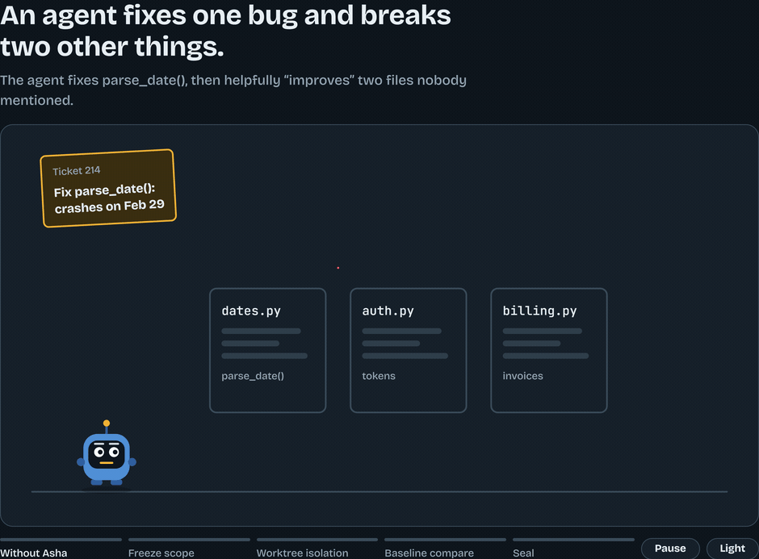

# Asha

**Asha verifies AI-generated code changes before you accept them.**

[](https://github.com/xenups/Asha/releases/tag/v0.7.4)
[](https://github.com/xenups/Asha/actions/workflows/ci.yml)

[](LICENSE)

Asha sits between an agent and your branch. It freezes the set of files a task
may touch, runs the work in its own Git worktree, runs your checks on both the
untouched baseline and the result, and records whether the evidence supports
accepting the change. When the evidence is missing or inconclusive it refuses
instead of reporting success.

[](docs/demo.html)

*Animated overview. [Open the interactive demo](docs/demo.html) for chapter
controls, play/pause and a light/dark toggle — standalone HTML, no build step:
`open docs/demo.html` (macOS), `xdg-open docs/demo.html` (Linux),
`start docs\demo.html` (Windows). No hosted demo URL: GitHub Pages is not
enabled for this repository.*

---

## 1. What is Asha

Asha is a governance and execution engine for AI-assisted software
development. It coordinates workers, controls the changes they declare,
verifies their results and seals auditable evidence before integration.

The pieces, kept deliberately separate:

| Layer | Responsibility | Where it lives |
| --- | --- | --- |
| Orchestration and governance | scope, worktree isolation, check matrix, baseline comparison, acceptance, evidence | **Asha** (`asha/`) |
| Agent execution and model interaction | running the prompt, calling the model, editing files | **Hermes** or another supported runner (spec `cmd` / `agent`) |
| Reasoning and code generation | producing the patch | the model behind that runner |
| Project environments | tests, lint, type checks | the target repository and its interpreter |
| Acceptance and evidence | PASS/FAIL, seal, ship authorization | **Asha**, deterministically |

Asha needs no API key for its own job: the model lives behind the runner, and
the gates are plain Python.

## 2. What problems it solves

| Failure | What Asha records |
| --- | --- |
| Unauthorized file changes | `INVALID_EVIDENCE / scope_violation:<path>` — any path outside `declared_scope` |
| Changed paths the caller did not account for | `unaccounted_paths` + `SCOPE_INCOMPLETE` (exit 2) |
| No-op worker claiming success | `FAILED / output_contract_not_satisfied:*` — the declared output contract is read from the tree before sealing |
| Regressions hidden by pre-existing failures | baseline vs. candidate failure **identities**: `NO_FAILURES`, `PRE_EXISTING_ONLY`, `NEW_FAILURES`, `UNKNOWN` |
| Unparseable baseline (collection error, crash, timeout) | `NOT_COMPARED / UNKNOWN` with `comparison_inconclusive:baseline_failures_unparsed` — never treated as an empty failure set |
| Wrong Python environment | interpreter resolution plus a fail-closed environment-gap diagnosis |
| Missing or inconclusive verification | a skipped required check is never a pass; `no_verification_ran` is reported |
| Repository-agnostic check matrix blocking a project | a trusted **verification profile** (0.7.4) declaring `REQUIRED` vs `NOT_CONFIGURED` |
| Untrusted verification configuration | profiles are operator-owned, repository-bound, digest-snapshotted, and fail closed |
| Evidence you cannot check later | SHA-256 evidence seal plus offline replay |

## 3. Core capabilities (v0.7.4)

- Single-worker execution: `asha --exec "cmd"` (in-place, governed) and
  `asha PATH` (zero-config status + tip seal).
- DAG-based multi-worker orchestration: `asha run --spec spec.json` with
  `deps`, one worktree per worker, topological scheduling
  (`asha/governance/dag.py`).
- Worker dependencies and declared task scope (`reads`, `writes`,
  `declared_scope`).
- Git worktree isolation per worker; the target branch is untouched unless
  `--apply` is given.
- Delegated agent execution: a worker's `cmd`, or `agent` + `task` for a
  delegated runner.
- Command and agent runners behind one spec schema; adapters ship in
  `asha/adapters/` (native, CI, agent).
- Python environment resolution for the target repository
  (`asha/verification_env.py`, `asha/governance/env_resolver.py`).
- Output contracts for code changes (`writes`, `output_kind: changes`),
  required artifacts (`required_artifacts`, `output_kind: artifact`) and
  explicit legitimate no-change outcomes (`no_change_reason`,
  `output_kind: no_change`).
- Clean Code mandatory Skill preload for workers, failing closed when the
  Skill is missing (`docs/WORKER-SKILL-POLICY.md`).
- Trusted, repository-bound verification profiles
  (`ASHA_VERIFICATION_PROFILE`, `docs/verification-profiles.md`).
- Required versus `NOT_CONFIGURED` checks: the latter is recorded with
  provenance and never counted as PASS.
- Baseline/candidate failure comparison with the verdicts above.
- Acceptance validation: `--acceptance CMD` must demonstrably pass; supplied
  but not executed, zero tests collected and skip/deselect-only runs fail.
- SHA-256 evidence sealing (`asha/evidence.py`) and offline replay
  (`asha/replay.py`).
- Governed integration and shipping decision: `--apply` runs the integration
  gate (`asha/integrator.py`) and the ship gate
  (`asha/governance/ship_gate.py`). A sealed worker PASS is not ship
  authorization.
- MCP server (`asha-mcp`, stdio JSON-RPC `2024-11-05`) exposing 14 tools, and
  a CLI with a stable JSON contract (`schema_version: 1`).
- Live execution observability: opt-in recording (`ASHA_TELEMETRY=1`) and a
  read-only loopback dashboard (`asha dashboard`, `docs/OBSERVABILITY.md`).
- Host-driven Ladder review over an exact commit range (`asha_review*` MCP
  tools, `docs/LADDER.md`).
- AST/CodeGraph context reduction behind `--context FILE:SYMBOL` and
  `asha_get_surgical_context` (`asha/ast_indexer.py`, `asha/codegraph.py`,
  `asha/context_slicer.py`).

## 4. How it works

```
Task (spec.json, or one governed command)
  -> Asha orchestrator / DAG coordinator
  -> worker: Hermes, another runner, or a plain command
  -> isolated Git worktree (target branch untouched)
  -> output contract + declared_scope validation
  -> project verification (check matrix or verification profile)
  -> baseline vs. candidate failure comparison
  -> acceptance validation (when --acceptance is given)
  -> SHA-256 evidence seal
  -> integration / ship decision (--apply, ship gate)
```

Two distinctions the engine never blurs:

- **A sealed worker result is not authorization to ship.** Worker evidence
  records `authorized_to_ship: false`; the ship gate re-runs the matrix against
  the merged tree.
- **`UNKNOWN` is not `SAFE`.** An inconclusive comparison blocks authorization;
  it neither asserts nor rules out a regression.

Worktree isolation is path isolation, not a security sandbox.

## 5. Installation

Requires Python 3.11+ and `git`. The runtime is stdlib-only — no dependencies.

```bash
# from the release wheel (the supported install)
curl -LO https://github.com/xenups/Asha/releases/download/v0.7.4/asha-0.7.4-py3-none-any.whl
python -m pip install asha-0.7.4-py3-none-any.whl

# or from a clone
git clone https://github.com/xenups/Asha.git
cd Asha
python -m pip install -e .
```

Both register the `asha` and `asha-mcp` console scripts. **Do not run
`pip install asha`** — the PyPI project of that name is unrelated to this one.

Optional extras, only when you use those features:

```bash
pip install "asha[code-search]"   # tree-sitter / ast-grep AST tooling
pip install "asha[memory]"        # mem0 + chroma memory backend
pip install "asha[test]"          # pytest, ruff, mypy, mypy-baseline
```

## 6. Quick start

Minimal spec: one worker, one declared write, its own worktree.

```json
{
  "workers": [
    {
      "id": "docs",
      "deps": [],
      "reads": ["calc.py"],
      "writes": ["NOTES.md"],
      "declared_scope": ["NOTES.md"],
      "cmd": ["python", "-c", "open('NOTES.md','w').write('# notes\\n')"],
      "timeout": 120
    }
  ]
}
```

```bash
asha --root /path/to/repo run --spec spec.json           # audit-only: target untouched
asha --root /path/to/repo run --spec spec.json --apply   # apply through the integration gate
```

The repository must provide the checks to the interpreter Asha resolves
(`pytest` here); when no check can run the worker is `INVALID_EVIDENCE` with
`reason: no_verification_ran` — never a pass.

A successful worker — `DONE` means own checks passed, the diff stayed inside
`declared_scope`, the output contract was satisfied, the baseline comparison
ran and found no new failures, and the evidence document was sealed. Output
below is from a fixture repository whose `pytest` suite passes (abbreviated):

```json
{
  "status": "ok",
  "completed": ["docs"],
  "states": {
    "docs": {
      "state": "DONE",
      "validation_status": "PASS",
      "verification_status": "VERIFIED_NO_REGRESSION",
      "verdict": "NO_FAILURES",
      "baseline_failures": [],
      "current_failures": [],
      "delta_failures": [],
      "comparison": {"performed": true, "comparable": true,
                     "reason": "COMPARED", "verdict": "NO_FAILURES"},
      "output_contract": {"kind": "changes", "declared_writes": ["NOTES.md"],
                          "writes_observed": ["NOTES.md"], "satisfied": true}
    }
  },
  "evidence": {"docs": ".../orchestrator/task/docs.json"}
}
```

Exit code `0`; the target branch is unchanged by an audit-only run.

A repository whose checks cannot produce a parseable baseline (no tests
collected, a collection error) is **not** a pass:

```
state: FAILED   verification_status: COMPARISON_INCONCLUSIVE   verdict: UNKNOWN
```

A no-op worker is refused, not excused:

```
FAILED / output_contract_not_satisfied:no_change_in_declared_writes   (no seal)
```

Agents instead of commands: replace `cmd` with `"agent": "<name>"` and
`"task": "<prompt>"`. The same spec runs over MCP as `asha_run_spec`
(simulation unless `apply=true`).

Inspect evidence: the payload's `evidence` map points at each worker's
evidence document; `asha/replay.py` re-hashes it and re-checks byte integrity
instead of trusting the document's own claims.

Exit codes: `0` validation completed / no changes / evaluation-only,
`1` validation failed, `2` operational or engine error, `130` interrupted.
`--json` writes exactly one JSON document to stdout; diagnostics go to stderr.

## 7. CLI and MCP

CLI — flags may appear in any order, and a positional `PATH` binds the
repository root:

```bash
asha PATH                                   # zero-config status + tip seal
asha --verify [PATH] [--base R] [--acceptance CMD]
asha --stack B1 B2 [B3 ...] [--base R]      # ordered branch stack, zero worktrees
asha --context FILE:SYMBOL [FILE:SYMBOL ...]
asha --exec CMD... [--base R] [--json]      # atomic in-place governed command
asha [--root P] [--paths F ...] [--json] [--no-execute] [--acceptance CMD]
asha status [PATH] [--root P] [--json]      # read-only tip facts
asha run --spec FILE [--apply] [--keep-worktrees] [--preserve-on-failure]
asha dashboard [--root P] [--host H] [--port N]
```

MCP server: `asha-mcp`, or `python -m asha.mcp_server` (stdio JSON-RPC
`2024-11-05`, same handlers as the CLI). Registered tools — 14:

| Tool | Kind | Purpose | Required args | Side effects |
| --- | --- | --- | --- | --- |
| `asha` | execution | single entry point with deterministic routing: `cmd` > `branches` > `target` > `validation` > bare `root` | one of `cmd`, `branches`, `target`, `validation`, `root` | runs the routed governed operation; returns its payload |
| `asha_status` | read-only | HEAD, porcelain status, worktrees, control-lock state | `root` | none |
| `asha_plan_dag` | planning | static pre-flight DAG over import edges; never executes | `root`, `workers` | none |
| `asha_run_spec` | execution | run a run-spec through the governed engine | `spec_path` or `spec_content` | creates worktrees, writes evidence; applies only with `apply=true` |
| `asha_dispatch_task` | execution | one governed worker through the full pipeline | `root`, plus `prompt` or `cmd` | creates a worktree, runs checks, writes evidence |
| `asha_verify_tip` | verification | in-place, fail-closed verification of the working-tree tip | `root` | runs checks in place; writes a seal artifact |
| `asha_verify_stack` | verification | verify an ordered branch stack against a base ref, zero worktrees | `root`, `branches`, `base_ref` | runs checks per branch; writes seals |
| `asha_get_surgical_context` | read-only | AST/CodeGraph context for one symbol in one file | `repo_path`, `target_file` (or `targets`) | builds or refreshes the index cache |
| `asha_review` | review | start a Ladder review over a committed range; returns the Code Review packet | `root`, `base`, `head` | persists a review run |
| `asha_review_context` | read-only | bounded chunk of the pinned review target (diff or file) | `review_run_id` | none |
| `asha_review_submit_stage` | review | submit one stage you produced; validates order, schema, paths | `review_run_id`, `stage`, `findings`, `verdict` | persists the stage |
| `asha_review_next_stage` | read-only | packet for the next mandatory stage (CODE → SENIOR → SEMANTIC) | `review_run_id` | none |
| `asha_review_finalize` | verification | deterministic evidence validation plus the canonical ship gate over the submitted stages | `review_run_id` | persists the delivery decision |
| `asha_review_status` | read-only | read a persisted review by id, including after a restart | `review_run_id` | none |

Client setup is a standard stdio connection (`command: asha-mcp`, or
`command: python` with `args: ["-m", "asha.mcp_server"]`) for Hermes,
Antigravity, Claude Desktop, Cursor and Windsurf.

## 8. Configuration

| Setting | How | Notes |
| --- | --- | --- |
| Worker policy | `ASHA_WORKER_POLICY`, or policy fields in the spec | `docs/WORKER-SKILL-POLICY.md` |
| Skill preload | policy `skill` resolved from `skills/<name>/SKILL.md` | fails closed when the Skill is missing; opt out for non-coding work |
| Verification profiles | `ASHA_VERIFICATION_PROFILE=/path/profile.json` | operator-owned, repository-bound by git remote, digest-snapshotted; never selectable by a task field |
| Python environment | resolved per service and repository; Windows `.venv/Scripts` and POSIX `.venv/bin` | see `docs/ENVIRONMENT-DIAGNOSIS.md` when a failure may be environmental |
| Delegated runner | spec `agent` + `task`, or a shipped adapter | the model and its credentials belong to the runner, not to Asha |
| Telemetry and dashboard | `ASHA_TELEMETRY=1`, then `asha dashboard` | off by default; loopback only; never evidence |
| Semantic reviewer (optional) | `ASHA_SEMANTIC_REVIEW=1` plus `ASHA_LLM_*` | needs your own API key; disabled unless enabled |

Secrets are read from the environment only; no example in this repository
carries a literal credential.

## 9. Security and limitations

- Worktree isolation is **path isolation, not a sandbox**. Code under test runs
  with your user's permissions; a command the agent runs outside Asha is
  neither inspected nor blocked, and outbound traffic is not filtered.
- A SHA-256 seal establishes **evidence integrity, not code correctness**. A
  sealed run of a bad change is still a bad change.
- `UNKNOWN` is not `SAFE`: an inconclusive comparison blocks authorization
  without ruling a regression in or out.
- Asha's verdict is only as good as the configured checks. Missing, skipped or
  non-deterministic checks are reported (`no_verification_ran`,
  `EXECUTION_FAILED`) rather than passing silently.
- A sealed worker PASS does not authorize a ship; the ship gate re-runs the
  matrix against the merged tree.
- External runners and model providers fail independently of Asha. Their
  failures surface as `EXECUTION_FAILED`, not as a governance verdict.
- Human review remains necessary. Asha makes the boundary, the checks and the
  reason for a decision explicit and auditable; it does not replace judgement.

## 10. Further documentation

- [Orientation](docs/ORIENTATION.md) — module map and invariants of the current engine.
- [Verification profiles](docs/verification-profiles.md) — schema, trust rules, failure modes.
- [Worker Skill policy](docs/WORKER-SKILL-POLICY.md) — mandatory Skill preload for workers.
- [Environment diagnosis](docs/ENVIRONMENT-DIAGNOSIS.md) — is it the code or the machine.
- [Ladder review](docs/LADDER.md) — commit range to governed delivery decision.
- [Observability](docs/OBSERVABILITY.md) — event schema, storage layout, dashboard API.
- [Linux server deployment](docs/LINUX_SERVER_DEPLOY.md) — deploy and smoke-test on a node.
- [Archive index](docs/archive/INDEX.md) — historical design documents, frozen benchmarks, superseded material.

## License

MIT — see [LICENSE](LICENSE). Copyright (c) 2026 Asha contributors.
