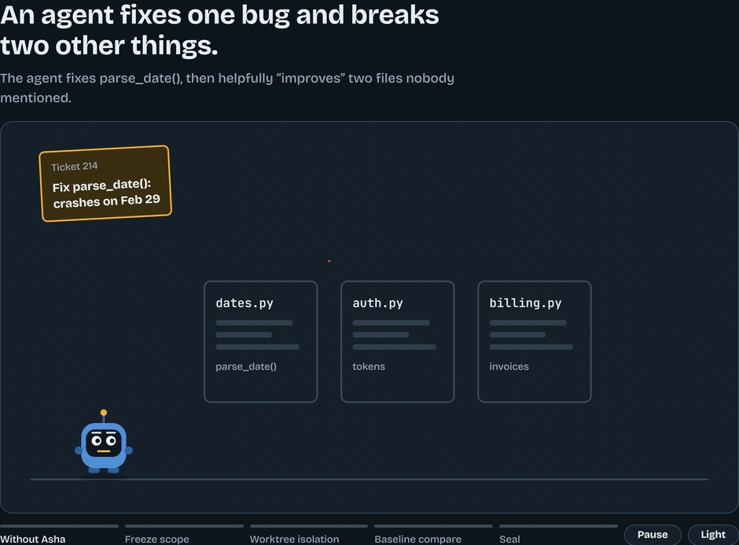

# Asha

**Asha helps you verify AI-generated code changes before you accept them.**

[](https://github.com/xenups/Asha/releases/tag/v0.5.0)
[](https://github.com/xenups/Asha/actions/workflows/ci.yml)

[](LICENSE)

AI coding agents can change files you did not authorize, break things that used
to work, or report success without enough evidence to back it up. Asha adds a
checkpoint between the agent and your branch: it freezes the set of files the
task may touch, runs the change in its own Git worktree, runs your checks on both
the untouched baseline and the result, and then records whether the evidence
supports accepting the change.

Asha does not guarantee bug-free code, and it does not replace human review. What
it does is make the boundary, the checks and the reason for accepting or
rejecting a change explicit and auditable — and it refuses to call a run
successful when the evidence is missing or inconclusive.

**What Asha does not control.** These checks govern the work Asha runs itself:
the worktree it creates and the files its workers change. Asha is not a sandbox
and has no hook into your agent's shell, filesystem or network calls — a command
the agent runs outside Asha is neither inspected nor blocked, and outbound
traffic is not filtered. Scope enforcement means file-write scope inside an
Asha-managed run; agent-wide control needs a separate enforcement layer.

[](docs/demo.html)

*Animated overview of the five stages. [Open the interactive demo](docs/demo.html)
for chapter controls, play/pause and a light/dark theme toggle — standalone HTML,
no build step: `open docs/demo.html` (macOS), `xdg-open docs/demo.html` (Linux),
`start docs\demo.html` (Windows).*

GitHub Pages is not enabled for this repository, so there is no live demo URL.

---

## The problem it solves

Agent-driven changes fail in three ways that a green test suite does not catch.

**1. Scope creep.** The agent fixes `parse_date()` and also "tidies" two files
nobody mentioned. Asha records the observed diff and rejects any path outside
`declared_scope`:

```
INVALID_EVIDENCE / scope_violation:src/forbidden.py
```

**2. Silent regressions.** The candidate's test run fails — but some of those
tests already failed before the change. A bare exit code cannot tell the two
apart. Asha runs the same check matrix on a clean baseline worktree at the base
commit and reports the *delta*, so a passing candidate is never blamed for, or
excused by, failures it did not create:

```
DONE    / COMPARED / NO_FAILURES
FAILED  / COMPARED / NEW_FAILURES      (failure identities recorded)
```

**3. The empty-baseline fallacy.** A baseline that *ran and failed* without a
parseable failure identity (collection error, crash, timeout) is not a known
empty failure set. Asha keeps that distinct from "compared, nothing failed":

```
baseline_failures: null          # unknown — not []
FAILED / NOT_COMPARED / UNKNOWN
reason: comparison_inconclusive:baseline_failures_unparsed   (no seal)
```

A baseline that never produced checks at all is `NOT_COMPARED` and keeps the
historical `DONE` contract: there is nothing to attribute.

## The five-stage workflow

1. **Freeze scope — `spec.json`.** Each worker declares `reads`, `writes` and
   the `declared_scope` that will be enforced.
2. **Worktree isolation.** The worker executes in its own Git worktree, so an
   in-flight change cannot touch the target branch or a sibling worker's files.
3. **Scope validation.** Observed changes are diffed against `declared_scope`.
   Unauthorized paths produce `INVALID_EVIDENCE`; changed paths the caller did
   not account for produce `unaccounted_paths` and `SCOPE_INCOMPLETE` (exit 2).
4. **Baseline vs. candidate delta gate.** The base commit is checked in a
   separate baseline worktree; failing identities are compared and classified
   (`NO_FAILURES`, `PRE_EXISTING_ONLY`, `NEW_FAILURES`, `UNKNOWN`).
5. **SHA-256 evidence seal.** The evidence document is hashed and bound to the
   run, and is issued only when the gates above pass.

Worktree isolation is path isolation, not a security sandbox. A SHA-256 seal
proves the recorded evidence was not altered — not that the code is correct.

## v0.5.0 highlights

- **Governed comparison contract.** Every governed run records `performed`,
  `comparable`, `reason` and `detail` for the baseline comparison, plus
  `baseline_failures`, `current_failures` and `delta_failures` when the
  comparison actually ran. `reason` is `COMPARED`, `NOT_COMPARED`,
  `BASE_EQUALS_TARGET` or `INVENTORY_MISMATCH`; tree identifiers are never
  invented.
- **Fail-closed identity.** `baseline_failures_unparsed` yields an inconclusive
  comparison, a `FAILED` worker, no seal, and no authorization for dependents.
- **Acceptance gate.** `--acceptance CMD` must demonstrably pass: supplied but
  not executed, zero tests collected, and skip/deselect-only runs all fail. The
  record (`command, supplied, ran, exit_code, outcome`) is sealed into worker
  evidence, and a command that never ran keeps `exit_code: null`.
- **Scope accounting.** `unaccounted_paths` is written into every payload and
  `SCOPE_INCOMPLETE` exits 2 instead of reporting a pass.
- **Worktree source binding.** A worktree run takes dependencies from the
  original checkout while imports stay bound to the worktree's own source; a
  fail-closed probe refuses to validate another checkout's copy. Windows
  `.venv/Scripts` layouts are supported alongside POSIX `.venv/bin`.
- **MCP server.** `asha-mcp` and `python -m asha.mcp_server` are the same stdio
  JSON-RPC server (protocol `2024-11-05`). The v0.5.0 release was smoke-tested
  for the initialization handshake — not certified against every client.
- **Measured runtime.** In the frozen A–D benchmark the Asha/direct wall-time
  ratio was `1.042×` median and `1.089×` mean (three trials; see below).

### Governance overhead, measured honestly

The local scope and evidence gates are deterministic Python and add no model
calls of their own. That does **not** mean an end-to-end run uses no extra
tokens: the measured ratios below vary above and below `1.0` depending on prompt
caching and call count.

## Quickstart

Requires Python 3.11+ (stdlib only; no runtime dependencies).

```bash
git clone https://github.com/xenups/Asha.git
cd Asha
pip install -e .            # registers the `asha` and `asha-mcp` console scripts
```

Minimal `spec.json` — one worker that writes one file and stays inside its
declared scope:

```json
{
  "workers": [
    {
      "id": "docs",
      "deps": [],
      "reads": ["calc.py"],
      "writes": ["NOTES.md"],
      "declared_scope": ["NOTES.md"],
      "cmd": ["python", "-c", "open('NOTES.md','w').write('# notes\\n')"],
      "timeout": 120
    }
  ]
}
```

Run it against a repository. Audit-only by default — the target branch is
untouched; `--apply` merges verified results through the integration gate:

```bash
asha --root /path/to/repo run --spec spec.json
```

Real output from exactly this spec (paths and hashes abbreviated):

```json
{
  "status": "ok",
  "completed": ["docs"],
  "states": {
    "docs": {
      "state": "DONE",
      "verdict": "NO_FAILURES",
      "baseline_failures": [],
      "current_failures": [],
      "delta_failures": [],
      "comparison": {
        "performed": true,
        "comparable": true,
        "reason": "COMPARED",
        "verdict": "NO_FAILURES"
      }
    }
  },
  "evidence": {"docs": ".../orchestrator/task/docs.json"}
}
```

`DONE` here means: the worker's own checks passed, its diff stayed inside
`declared_scope`, the baseline comparison ran and found no new failures, and the
evidence document was sealed. Exit codes: `0` validation completed / no changes,
`1` validation failed, `2` operational or engine error, `130` interrupted.
`--json` writes exactly one JSON document to stdout; diagnostics go to stderr.

Agents instead of commands: replace `cmd` with `"agent": "<name>"` and
`"task": "<prompt>"`. The same spec runs through MCP as `asha_run_spec`
(simulation unless `apply=true`).

### Other entry points

```bash
asha --root /path/to/repo status                  # read-only tip facts
asha --root /path/to/repo --paths src/calc.py     # validate a known change set
asha --root /path/to/repo --acceptance "python -m pytest -q tests"
asha --root /path/to/repo --verify                # in-place tip verification
python -m asha.mcp_server                         # MCP over stdio (== asha-mcp)
```

MCP tools: `asha` (auto-routing entry point), `asha_status`, `asha_plan_dag`,
`asha_run_spec`, `asha_verify_tip`, `asha_verify_stack`,
`asha_get_surgical_context`, `asha_dispatch_task`. Client setup (Antigravity,
Hermes, Claude Desktop, Cursor, Windsurf) is a standard stdio connection:
`command: asha-mcp` or `python -m asha.mcp_server`.

## Benchmark: frozen A–D reproducibility experiment

Three repeated trials × four frozen scenarios × two methods = 24 execution arms,
i.e. 12 paired comparisons. These are **four scenarios**, not 24 task types.

| Scenario | Direct execution | Asha v0.5.0 | Governance outcome |
|---|---|---|---|
| **A** — valid change | Accepted | `DONE / COMPARED / NO_FAILURES`; accepted; sealed | Valid change passed |
| **B** — injected regression | Rejected | `FAILED / COMPARED / NEW_FAILURES`; not sealed | Regression blocked |
| **C** — unparseable baseline failure | Accepted | `FAILED / NOT_COMPARED / UNKNOWN`; `comparison_inconclusive:baseline_failures_unparsed`; not sealed | Unknown baseline failed closed |
| **D** — scope violation | Modified both allowed and forbidden files | `INVALID_EVIDENCE / NOT_COMPARED`; `scope_violation:src/forbidden.py`; not sealed | Unauthorized change rejected |

The same categorical outcomes were observed in all three trials.

**Scenario B regression identities** (recorded):

- Ruff `F811` at `parity.py:9:5` — `is_even` redefined.
- Pytest failure `tests/test_parity.py::test_three`.

**Scenario D:** the direct arm modified both `src/allowed.py` and
`src/forbidden.py`; Asha rejected the forbidden-path change.

### Wall time (Asha ÷ direct)

| Trial | Ratio |
|---|---:|
| 1 | 1.023× |
| 2 | 1.203× |
| 3 | 1.042× |
| **Median** | **1.042×** |
| **Mean** | **1.089×** |

### Token usage

Observed ratios varied from roughly `0.62×` to `1.02×`, with 3–6 model calls per
arm; prompt caching and call count changed between trials. Provider billing cost
was not measured — the recorded estimated cost of `$0.0` is not evidence of zero
real cost.

### What this evidence is and is not

- Frozen inputs and evaluators; their hashes were unchanged across the three
  trials.
- A controlled reproducibility experiment, not a large independent production
  study. No statistical significance is claimed and no confidence intervals are
  reported, because none were computed.
- The four scenarios test specific behaviors (valid change, injected regression,
  unparseable baseline, scope violation). They do not establish general
  correctness or a universal performance advantage.
- Wall-time results are specific to the tested environment and task harness.
- Direct execution accepting scenario C shows a limitation of the direct
  comparator for that scenario — not that every ungoverned agent fails this way.

## Limitations and trust model

- Git worktrees give **path isolation**, not process or network sandboxing. Code
  under test runs with your user's permissions.
- A SHA-256 seal establishes **evidence integrity**, not code correctness. A
  sealed run of a bad change is still a bad change.
- `UNKNOWN` is not `SAFE`. An inconclusive comparison blocks authorization; it
  neither asserts nor rules out a regression.
- Asha's verdict is only as good as the configured checks. Missing, skipped or
  non-deterministic checks are reported (`no_verification_ran`,
  `EXECUTION_FAILED`) rather than passing silently.
- A worker passing its own tree does not authorize a merge: the integration gate
  re-runs the matrix against the merged tree. `push` is not `done`, and a commit
  is not ship authorization.
- The benchmark above is bounded evidence from four frozen scenarios.

## Further reading

- [Governance orientation](docs/ORIENTATION.md) — module map and invariants.
- [Linux server deployment](docs/LINUX_SERVER_DEPLOY.md)
- [Design specs](docs/phase-5.0-design.md)
- [v0.5.0 release notes](https://github.com/xenups/Asha/releases/tag/v0.5.0)
- The previous README revision (full CLI contract, MCP tool reference, telemetry
  protocol, code-graph → worker-DAG model, phase roadmap) remains in Git history
  at commit `3c462b9`.

## License

MIT — see [LICENSE](LICENSE). Copyright (c) 2026 Asha contributors.
