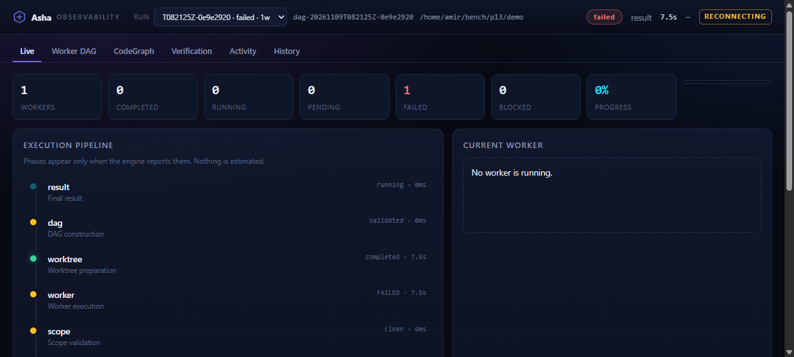
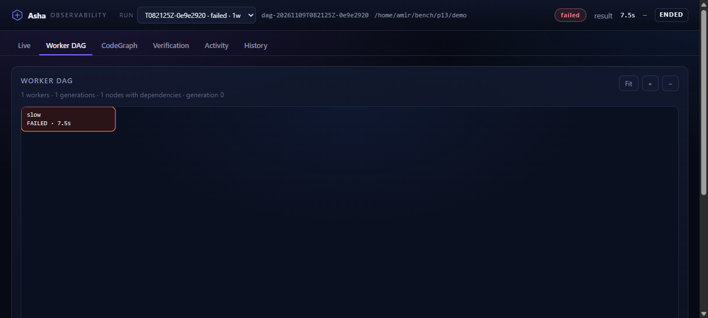
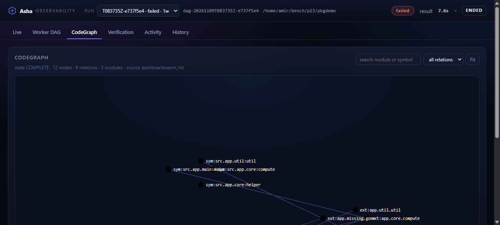
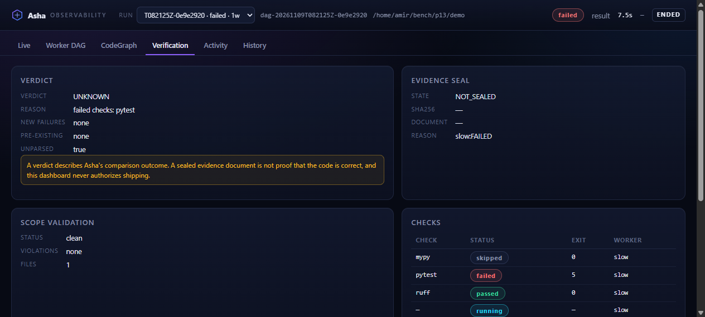
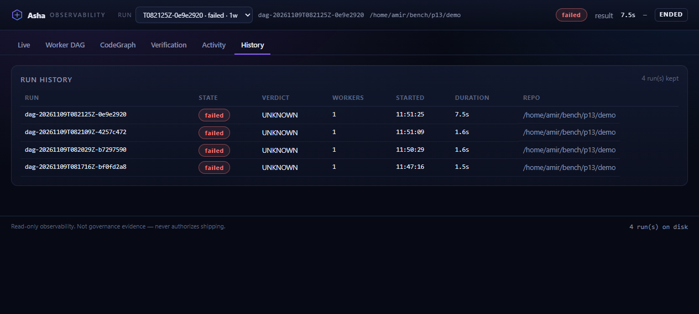

# Observability — live execution dashboard

Asha can record what it actually does while it runs and show it in a local,
read-only web dashboard. This is an **observability layer**, not a second
orchestrator and not governance evidence: nothing here can approve, reject,
modify or seal a run.

```
engine  ──emit()──▶  JSONL run store  ──read──▶  loopback HTTP + SSE  ──▶  browser
(in-process, no-op unless ASHA_TELEMETRY=1)      (asha dashboard)
```

## 1. Enable recording

Recording is **off by default**. Any `asha` command started with
`ASHA_TELEMETRY=1` writes one event stream per run:

```bash
ASHA_TELEMETRY=1 asha run --spec task.json        # CLI run
ASHA_TELEMETRY=1 asha-mcp                          # MCP server (stdio)
```

With the variable unset the sink is a `NullSink`: one function call, no I/O,
no file, no directory.

## 2. Open the dashboard

```bash
asha dashboard --root /path/to/checkout            # 127.0.0.1:7331
asha dashboard --root . --port 8123                # choose a port
```

`asha dashboard` starts a stdlib HTTP server bound to loopback, prints the
URL and stops on Ctrl+C. It does **not** start a run, does **not** start an
engine, and refuses any non-loopback `--host`.

Attaching to an execution that is already running needs nothing from the
engine: open the dashboard before, during or after a run — the store is
append-only and the page replays from sequence 0. Share a specific run with
`http://127.0.0.1:7331/?run_id=<id>`.

## 3. What is instrumented (real call sites)

| Emitted | Where |
|---|---|
| `run.started`, `run.completed` / `run.failed`, `dag.created`, `dag.validated` | `DAGCoordinator.run` (and the legacy `GovernedScheduler.run`) |
| `worker.queued` / `ready` / `started` / `completed` / `failed` / `blocked` / `cancelled` | `DAGCoordinator._set` — the single worker state choke point |
| `worktree.create.started` / `completed`, `worktree.cleanup.completed` | around `WorktreeDispatcher` calls |
| `scope_validation.started` / `completed` | `worker_execution.collect_worker_evidence` |
| `baseline.started` / `completed`, `candidate_check.started` / `completed` | the same function, around the real check runs |
| `delta.computed`, `verdict.computed` | where `delta.verdict_for` decides |
| `evidence.created` / `validated` / `sealed` / `rejected` | around `evidence.seal` + `verify_worker_evidence` |
| `planning.started` / `completed` | `asha_run_spec` pre-flight |
| `codegraph.build.completed` / `load.completed` | `graph_cache.load` (cache hit = load, rebuild = build) |
| `context_slice.started` | the `asha_get_surgical_context` call site |

Not emitted, because Asha does not observe them: a worker's private
reasoning, an LLM token stream, CPU/memory of a child process, progress of a
long external command. The dashboard never invents them.

## 3a. CodeGraph source

The CodeGraph view shows a run's own `codegraph.*` event when the run built a
graph. When it did not, the dashboard builds one for the run's `--root` through
`asha.graph_cache.load` (Asha's own indexer, its own cache — cold, warm-hit or
purged), labels the source `dashboard:<mode>` and caches the projection for
60 s. It never renders a graph it did not obtain from Asha.

The root itself is validated first: it must be non-empty, an existing
directory and a Git repository (`.git` as a directory, or as a file for a
linked worktree). An empty or invalid root is answered with
`{"available": false, "state": "UNKNOWN", "reason": "..."}` and no graph
loading happens at all — the dashboard never falls back to its own working
directory, so a graph belonging to another checkout can never be presented as
this run's CodeGraph.

## 4. Event schema (v1)

```json
{"schema_version": 1,
 "run_id": "dag-20261109T101500Z-1f4c9a2b",
 "sequence": 42,
 "timestamp": "2026-11-09T10:30:00.412Z",
 "event_type": "worker.started",
 "component": "dag_coordinator",
 "stage_id": "worker",
 "worker_id": "w1",
 "status": "RUNNING",
 "message": "worker began in its worktree",
 "data": {"task": "...", "reads": ["a.py"], "writes": ["b.py"],
          "declared_scope": ["b.py"], "deps": ["w0"]}}
```

* `sequence` is per run, gapless and monotonic; SSE `id:` is that number, so a
  reconnecting browser resumes exactly where it stopped (`Last-Event-ID`).
* `timestamp` is UTC with milliseconds.
* Payload strings are redacted (token/secret/password/api-key shapes and
  secret-named keys) and bounded; `data` is depth- and length-limited.
* One record never exceeds **64,000 UTF-8 bytes** (`MAX_EVENT_BYTES`).
  Oversized optional collections are pruned to a deterministic prefix —
  largest lists first, 200 → 1 items — and the loss is written into the record
  itself: `data.truncation = {"truncated": true, "kept": 200, "omitted":
  {"nodes": 400}}`. Edge and relation endpoints are filtered to the nodes that
  survived, so a pruned DAG has no dangling edges. A graph that lost nodes is
  downgraded from `COMPLETE` to `INCOMPLETE`; it is never reported complete.
* A record is serialized once, measured in UTF-8 bytes, and re-serialized
  after each pruning step. Serialized JSON is never cut by character offset, so
  every line in `events.jsonl` parses. If even a pruned payload cannot fit,
  the envelope survives with `data = {"truncated": true, "reason": "..."}` —
  the event stays visible in replay and in the activity log.
* The emit-side scrub also caps collections at 200 items and records the same
  `data.truncation` marker, so nothing is dropped silently.
* A run without a terminal event whose process is gone reads `INTERRUPTED` —
  never `COMPLETED`.

## 5. Storage

```
$ASHA_STATE_DIR | ${XDG_STATE_HOME:-~/.local/state}/asha
  <checkout-hash>-<name>/observability/runs/<run_id>/
    meta.json      # run id, root, command, task, pid, started_at
    events.jsonl   # append-only, one JSON object per line
```

The directory lives outside every worktree, so events can never appear in a
diff, a scope violation or an evidence seal, and two runs never share a file.
Retention is manual (`store.prune(root, keep=N)`); nothing is deleted
automatically.

## 6. HTTP API

```
GET /api/health
GET /api/runs
GET /api/runs/{run_id}                 # meta + derived snapshot
GET /api/runs/{run_id}/graph           # {"dag": ..., "codegraph": ...}
GET /api/runs/{run_id}/events?after=&limit=&type=&worker=&q=
GET /api/stream?run_id={run_id}&after={seq}
```

Read-only by construction: there is no route that writes, executes or
deletes, and no path is built from user input (run ids match
`^[A-Za-z0-9][A-Za-z0-9_.-]{0,127}$`; static assets are a fixed whitelist).

## 7. Browser views

Real captures from a two-worker demo run (`asha run` against a scratch repo,
recorded with `ASHA_TELEMETRY=1`):








* **Live** — header (run, repo, status, current phase, elapsed, progress),
  worker counters, a pipeline whose phases come from emitted events only,
  a narrow "current worker" panel and the newest events.
* **Worker DAG** — the nodes/edges of the emitted `dag.created` projection,
  laid out by topological generation, coloured by real state, clickable
  (task, reads, writes, declared scope, deps, duration, reason). Zoom, pan,
  fit; off-screen nodes are culled.
* **CodeGraph** — modules/symbols and relations from the CodeGraph build,
  with COMPLETE / INCOMPLETE / UNKNOWN kept visually distinct. If no graph
  was built in the run, the view says so instead of drawing anything.
* **Verification** — verdict, evidence seal + SHA-256, scope validation,
  check records and per-worker verdicts. It states explicitly that a seal is
  not proof of correctness and grants no authorization.
* **Activity** — every event, filterable by severity/worker/text, expandable,
  copyable, auto-scroll pausable.
* **History** — every run on disk with state, verdict, worker count and
  duration; clicking opens it read-only.

## 8. Security

Loopback bind by default (non-loopback refused), strict run-id validation, no
arbitrary file serving, no shell/command endpoints, CSP `default-src 'self'`
with no external assets, `nosniff`/`DENY`/`no-referrer` headers, escaped DOM
(no `innerHTML` with data), redacted and bounded payloads, malformed JSONL
lines skipped instead of crashing. Environment variables, tokens and
credentials are never recorded.

MCP integrity is unchanged: events go to files, diagnostics to stderr; stdout
stays exclusively JSON-RPC (covered by
`tests/test_observability.py::test_mcp_stdout_stays_jsonrpc_with_telemetry_on`).

## 9. Overhead

One `emit()` call per lifecycle point, a JSON serialisation and an append to
an already-open file descriptor; no network, no database, no LLM call, no
extra process while recording. The dashboard server only reads. Graph views
are rendered from the cached snapshot (debounced at 700 ms per burst of
events), never rebuilt per event.

## 10. Known limitations

* Instruments the DAG/scheduler lifecycle in-process. A worker's own
  subprocess stdout is only visible as the check `output_tail` the engine
  already captures; it is not streamed line by line.
* `run.cancelled` / `run.interrupted` are not emitted yet: a killed process
  leaves the run `INTERRUPTED` by absence of a terminal event.
* CodeGraph events depend on the graph cache being assembled in that run
  (`asha_run_spec` does; a bare internal call that skips the cache will show
  "no CodeGraph event"). The dashboard's own projection is only attempted for
  a validated Git root and is labelled `dashboard:<mode>`.
* A pruned DAG or CodeGraph is shown with a `TRUNCATED` marker next to the
  node/relation counts; the node cap is 200 per event, so very wide DAGs
  (>200 workers) are visible as a partial graph with explicit counts rather
  than as a complete one.
* No authentication beyond loopback binding. On a shared host, treat the
  dashboard as readable by any local user and set `--port` accordingly.
* Retention is manual; each run's `events.jsonl` grows with the event count
  of that run only.
* Telemetry is optional and must not be treated as evidence: the governance
  verdict comes from the sealed evidence documents, which are written whether
  or not the dashboard is enabled.
